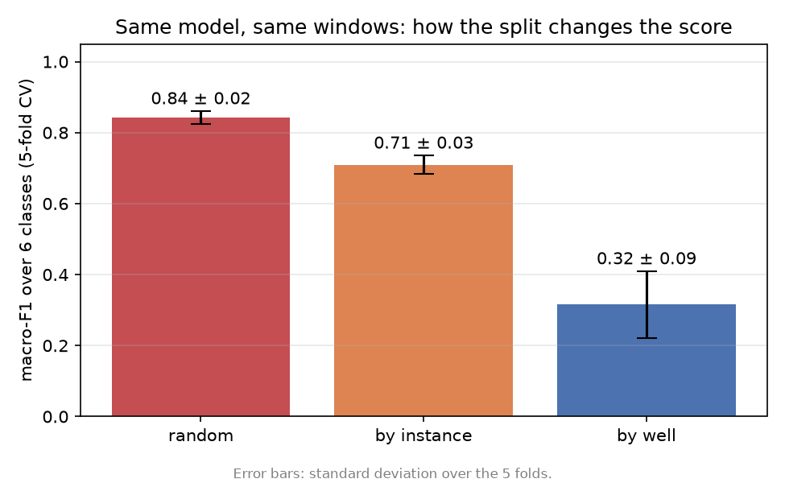

# timenet-3w

Recognizing abnormal events in offshore oil wells from raw sensor data, with
[OpenTSLM](https://github.com/OpenTSLM/OpenTSLM) and [TimeNet](https://github.com/OpenTSLM/TimeNet),
evaluated on wells the model has never seen.
Project for the [TimeNet Online Hackathon](https://challenge.timenet.ai/), Round 1 (November 2026).

| | |
|---|---|
| **TimeNet PR** | [OpenTSLM/TimeNet#833](https://github.com/OpenTSLM/TimeNet/pull/833): Petrobras 3W as the `petrobras/three-w` dataset, in TimeNet's `industrial` domain |
| **Demo** | [huggingface.co/spaces/timenet-3w/3w-on-timenet](https://huggingface.co/spaces/timenet-3w/3w-on-timenet): test windows with both models' answers, the test results, split leakage and lead time |
| **Data** | [Petrobras 3W](https://github.com/petrobras/3W) v2.0.0, CC BY 4.0 |

## In short

- **3W is now a TimeNet dataset.** The connector reads 2,228 instances from pinned, SHA-256-checked
  files and builds 2,228 classification tasks and 1,142 event-localization tasks. Missing sensors are
  declared, never filled.
- **We evaluate by well, not by window.** On the same model and windows, macro-F1 is 0.84 with a
  random split, 0.71 when we split by instance and **0.32 when we split by well**. Only the last one
  measures what happens on a new well.
- **OpenTSLM fine-tuned on 3W does not beat an XGBoost baseline on unseen wells.** On the held-out test
  wells it scores 0.35 macro-F1 against 0.40 (paired difference −0.05, CI −0.16 to 0.02). Under
  cross-validation by well the two are tied (0.34 ± 0.03 against 0.32 ± 0.03). On test it raises many more false alarms.
- **OpenTSLM does read the signal, but it leans on the statistics in its prompt.** Shuffling the time
  order while leaving the prompt's mean and std untouched drops validation macro-F1 from 0.51 to
  0.19. On validation, when the signal and the statistics point to different classes, the answer
  follows the statistics about twice as often as the signal (on test the conflict is inconclusive).
- **Explanations are checked, not trusted.** A second model writes a short description of what the
  sensors did, then answers. A script re-measures every claim against the data: 0.05% of claims name
  a sensor that is not there and 3% give the wrong direction of change. These explanations do not
  improve accuracy.

## Problem

Abnormal events in oil wells, such as flow instability, hydrate in the production line or a spurious
closure of the downhole safety valve, cost production and raise safety and spill risks. 3W is the
public benchmark for this: 1,119 real instances from 40 wells (plus simulated and hand-drawn ones),
27 sensors at 1 Hz, 10 classes. Every well has a different set of working sensors, and a model
deployed on a new well has never seen that well before. That is the setting we test.

## Data in TimeNet

The connector lives in our fork, branch `feature/petrobras-three-w`, under
`datasets/petrobras/three_w/`. It is submitted upstream as PR #833, where a maintainer has already
updated it to the new connector API. Everything here is built from that dataset, not from the raw Parquet files:

```powershell
uvx --from "git+https://github.com/RenatoGallicola/TimeNet@feature/petrobras-three-w#subdirectory=packages/timenet-connectors" timenet-build build petrobras/three-w --no-isolation --local-registry ..\registry
uv run python scripts/make_windows.py ..\registry ..\data\windows --splits splits/wells_connector.json
```

The second command cuts **18,737 windows of 30 minutes** (180 points at 0.1 Hz) from 39 real wells.
It uses the connector's split by well (12,827 train, 2,690 validation, 3,220 test windows), 6 sensors
(`P-TPT`, `T-TPT`, `P-ANULAR`, `P-MON-CKP`, `P-JUS-CKGL`, `T-JUS-CKP`) and the 6 classes that have
real instances in at least 6 wells:

| Code | Class |
|---|---|
| 0 | Normal operation |
| 2 | Spurious closure of DHSV |
| 4 | Flow instability |
| 7 | Scaling in PCK |
| 8 | Hydrate in production line |
| 9 | Hydrate in service line |

`scripts/compare_windows.py` checks that the windows are identical to windows cut from the original
Parquet files. Missing sensors stay NaN with a mask. The window format is in
[`docs/DATA_CONTRACT.md`](docs/DATA_CONTRACT.md).

## Method

**Baselines** (`scripts/baselines.py`): XGBoost on either scale-free shape features (trend,
change, roughness, autocorrelation) or only the mean and std of each sensor. Two findings shaped the rest of the
project:

1. **Shortcut: which sensors exist.** Each well has different sensors, so without countermeasures
   the model learns sensor presence. On new wells it then recognized 0 flow-instability windows.
   Random sensor dropout during training fixed it (class F1 0.50 on the test wells). Absolute levels
   are left out.
2. **Mean and std alone carry much of the signal**: 0.37 against 0.38 for shape features in 5-fold
   CV by well (but 0.26 against 0.40 on test). OpenTSLM writes exactly those numbers into its prompt, so it needs perturbation tests (below).

**OpenTSLM** (`scripts/opentslm_bridge.py`, `scripts/opentslm_modal.py`): OpenTSLM-SoftPrompt on
Llama 3.2 1B. Training starts from the published `OpenTSLM/llama-3.2-1b-har-sp` checkpoint, which was
trained on multichannel accelerometer classification. The bridge turns each window into an OpenTSLM
sample:
- each present sensor is z-normalized for the encoder;
- the prompt gives each present sensor's code, description, mean and std;
- the target is the class name.

The model is trained with fully class-balanced sampling and random sensor dropout. The encoder,
projector and LoRA adapters are trained; the LLM stays frozen. Two epochs on an A100 (about 12 minutes
each) on Modal's free credits; epoch 1 was kept, on validation macro-F1. The checkpoint and the
settings were chosen on validation wells only. The test wells were frozen from 2026-11-20 and scored once.

**Checked explanations** (`scripts/rationales.py`): for every training window a script writes what
the shown sensors did, never mentioning the class. For example:

> P-TPT drops by 52.5 bar (from 144.02 to 91.52 bar). P-JUS-CKGL drops by 10.1 bar (from 122.4 to
> 112.32 bar). P-MON-CKP drops by 12.2 bar (from 26.40 to 14.20 bar). The other sensors are stable.
> Answer: Hydrate in production line

A second OpenTSLM model is trained to write such a text and then the answer. Every sentence it
generates is parsed and re-measured on the window: does the sensor exist, is the direction right, is
the number within tolerance, did it call a salient change "stable"?

## Results

All numbers are macro-F1 over the 6 classes unless stated otherwise. **Event recall** is the share of
event windows flagged as any event. **False alarms** is the share of normal windows flagged as an
event. The scripts that produce each number are in `scripts/`, and the outputs are in `results/`.

### Split leakage (`results/split_leakage/`)

Same XGBoost model and windows, 5-fold cross-validation on train and validation:

| Split | Macro-F1 |
|---|---|
| Random windows | 0.84 |
| By instance | 0.71 |
| **By well** | **0.32** |



### Test wells (scored once)

| Model | Macro-F1 | Event recall | False alarms |
|---|---|---|---|
| XGBoost, mean and std | 0.26 | 0.05 | 0.03 |
| XGBoost, shape features | **0.40** | 0.34 | **0.09** |
| OpenTSLM run 1 | 0.35 | **0.37** | 0.59 |

The paired bootstrap over instances gives OpenTSLM − XGBoost = −0.05 (CI −0.16 to 0.02). Per class
(F1, with the number of test wells and instances):

| Class | Wells | Instances | XGBoost | OpenTSLM |
|---|---|---|---|---|
| 0 Normal operation | 8 | 130 | 0.75 | 0.43 |
| 2 Spurious closure of DHSV | 1 | 3 | 0.99 | 0.88 |
| 4 Flow instability | 2 | 59 | 0.50 | 0.00 |
| 7 Scaling in PCK | 1 | 8 | 0.10 | 0.02 |
| 8 Hydrate in production line | 2 | 2 | 0.07 | 0.28 |
| 9 Hydrate in service line | 1 | 3 | 0.00 | 0.48 |

In the test split, classes 2, 7 and 9 come from one well each, so per-class numbers rest on 2 to 8
instances from one well. OpenTSLM's edge on classes 8 and 9 rests on 1 to 2 wells and is not evidence
that it generalizes. OpenTSLM called 1,000 of the 1,805 normal test windows "Scaling in PCK" and recognized no
flow-instability window. On validation it had scored 0.51 against 0.22 for XGBoost, but that gain did
not transfer: validation flow instability came from a single well.

### Cross-validation by well (3 folds over train and validation wells)

| Model | Macro-F1 (mean ± sd) | Event recall | False alarms |
|---|---|---|---|
| XGBoost, shape features | 0.317 ± 0.031 | 0.39 | 0.14 |
| OpenTSLM, balancing 1.0 | 0.343 ± 0.029 | 0.43 | 0.14 |
| OpenTSLM with explanations | 0.363 ± 0.086 | 0.39 | 0.28 |

The fold split is the one of `splits/folds_by_well.json`; the 5-fold figure of the split-leakage chart
(0.32) and of `results/baselines.json` (0.38 ± 0.13) use other folds. Class-balancing powers 0.5, 0.75
and 1.0 tie on macro-F1 (0.340, 0.351, 0.343). We kept 1.0 for its event recall (0.43 against 0.15 to
0.18 at similar false-alarm rates, 0.10 to 0.15). Explanations do not give a
robust gain (one fold worse) and double the false alarms, so the classifier stays label-only.

### Does OpenTSLM read the signal? (`results/perturbation/`)

`scripts/perturb.py` builds 6 versions of every window. OpenTSLM gets the series and the statistics
through two separate channels: the series goes to the encoder, normalized, and the mean and std go
into the prompt as text. Each perturbation breaks one channel:

| Condition | Series | Statistics in prompt | Validation | Test |
|---|---|---|---|---|
| original | own | own | 0.51 | 0.35 |
| time shuffle | own, time steps shuffled | own | 0.19 | 0.11 |
| noise | Gaussian noise with the window's mean and std | own | 0.21 | 0.11 |
| no statistics | own | none | 0.09 | 0.22 |
| signal from another class | other class | own | 0.26 | 0.16 |
| statistics from another class | own | other class | 0.11 | 0.12 |

Every drop from `original` has a paired bootstrap interval entirely below zero. On validation, time
shuffle costs −0.32 (CI −0.40 to −0.18), so the model uses the temporal shape. It is not just reading the
numbers in the prompt.

In the two conflict conditions, does the answer follow the window's own class or the class of the
part that was swapped in?

| Condition | Split | Follows the statistics | Follows the signal |
|---|---|---|---|
| signal from another class | validation | 0.45 | 0.19 |
| statistics from another class | validation | 0.41 | 0.16 |
| signal from another class | test | 0.25 | 0.18 |
| statistics from another class | test | 0.18 | 0.24 |

The rest of the answers name a third class. On validation, when the two channels disagree, the
statistics win about twice as often as the signal (the unperturbed answers matched the swapped-in
class only 7% of the time, so this is not chance). On test the conflict is inconclusive: the model
is weaker there, and its unperturbed answers already matched the swapped-in class 27% of the time.

The validation result matches an independent probe of the published `OpenTSLM/llama-3.2-1b-har-sp`
checkpoint on human activity recognition, which uses the same conditions
([opentslm-signal-probe](https://github.com/ariannabalducci/opentslm-signal-probe)). There, the
answer follows the statistics 2.2 to 2.5 times as often as the series, and shuffling time costs
about as much as replacing the series with noise. That model was trained on teacher rationales; ours
answers with the label only. The preference survives without rationales, but our model starts from
that checkpoint and may have inherited it. When the
signal carries no information, the model falls back to one default answer: "Normal operation" on
validation, "Scaling in PCK" on test. XGBoost shape features, which see only the series, drop from
0.22 to 0.06 under time shuffle on validation and from 0.39 to 0.14 on test (retrained, so 0.39 instead
of 0.40), and the statistics-only XGBoost does not move.

### Checked explanations (cross-validation mean)

| Check | Share of claims |
|---|---|
| Names a sensor that is not shown | 0.05% |
| Wrong direction of change | 3% |
| Fully correct (sensor, direction, numbers) | 62% |

Most errors are wrong numbers; the model also often calls a salient change "stable" (about 1,400
claims per fold). A property of the data shows the limit of these descriptions: in the training
windows of flow instability, the reference rationales say "all shown sensors are stable" for 0.5% of
the wells that record a sensor at the production choke (`P-MON-CKP` or `T-JUS-CKP`) and for 95% of
those that do not.

### Other results

- **Simulated instances** (`scripts/sim_augment.py`): adding 3W's simulated windows of classes 2, 8
  and 9 to the XGBoost training moves CV macro-F1 from 0.316 to 0.347 (± 0.09 to 0.13). The gain is
  weak and inside the noise. Simulated instances never record `P-ANULAR`, which is a possible
  shortcut.
- **Per-well normalization** (`scripts/well_norm.py`, XGBoost, 3 folds by well; rule fixed before
  the run in `docs/DECISIONS.md`): expressing each window's mean and std relative to its own well
  (median over all its windows, no labels) **hurts**. Shape features drop from 0.317 to 0.269 when the
  per-well levels are added. Relative mean and std reach only 0.14, while absolute mean and std reach
  0.34; spurious DHSV closure falls from 0.78 to 0.01-0.22. The absolute levels carry physics that
  transfers across wells, for example a pressure falling to a typical value when a valve closes, so
  they are not just a well-specific shortcut. A reference built from all of a well's windows also
  includes its events. Because XGBoost did not improve, the OpenTSLM run was not launched.
- **Lead time** (`scripts/lead_time.py`, XGBoost only, validation): windows slid across the event
  onset. A clear early signal appears only for class 2. We did not run it for OpenTSLM, so **we make
  no early-warning claim**.

## Limits

- The test split has 1 to 2 wells per event class. Per-class numbers and even macro-F1 move a lot
  with which wells land in test. The validation gain of OpenTSLM (0.51) disappeared on test (0.35).
- The bootstrap resamples instances, and windows of one well stay correlated, so read every interval
  as optimistic. We do not bootstrap over wells: there are too few.
- XGBoost uses fixed hyperparameters, and some of its feature choices were made after seeing test
  numbers, before the test wells were frozen on 2026-11-20 (`docs/DECISIONS.md`). This favours the
  baseline.
- One kept epoch, one backbone (1B), one architecture (SoftPrompt). Flamingo, larger backbones and
  ensembles were planned but not run.
- The explanations are descriptions of the signal that are checked against the data. They are not
  causal explanations of the event.
- We do not compare with the 35.1% of arXiv 2608.04041: different classes, protocol and split.

## Reproduce

Setup (Windows, uv, Modal, Hugging Face tokens in `.env`) is in [`docs/SETUP.md`](docs/SETUP.md).
After building the dataset and the windows (above):

```powershell
# Baselines and evaluation
uv run python scripts/baselines.py ..\data\windows results\baselines.json
uv run python scripts/evaluate.py ..\data\windows results\predictions\opentslm_sp_run1_test.csv --compare results\predictions\xgboost_shape_test.csv --split test

# OpenTSLM on Modal (A100)
uvx modal run scripts/opentslm_modal.py::upload --src ..\data\windows --name windows
uvx modal run scripts/opentslm_modal.py::train --run-name run1 --epochs 2
uvx modal run scripts/opentslm_modal.py::predict --run-name run1 --windows windows --split test --out opentslm_sp_run1_test

# Perturbation tests
uv run python scripts/perturb.py make ..\data\windows ..\data\perturbed --split test
# for each condition <c> (original, time_shuffle, noise_signal, signal_from_other, stats_from_other, no_stats):
uvx modal run scripts/opentslm_modal.py::upload --src ..\data\perturbed\<c> --name <c>
uvx modal run scripts/opentslm_modal.py::predict --run-name run1 --windows <c> --split test --out opentslm_sp_run1_<c>_test
uv run python scripts/perturb.py xgboost ..\data\windows ..\data\perturbed --split test   # writes ..\data\perturbed\xgboost_test.json
uv run python scripts/perturb.py score ..\data\perturbed results\perturbation --predictions results\predictions\opentslm_sp_run1 --split test

# Folds by well, split leakage, rationales
uv run python scripts/make_folds.py ..\data\windows ..\data\folds --xgboost
uv run python scripts/split_leakage.py ..\data\windows results\split_leakage
uv run python scripts/rationales.py ..\data\windows --split val --check-file results\predictions\opentslm_rat_main_val.csv
```

Every decision, with its date and reason, is in [`docs/DECISIONS.md`](docs/DECISIONS.md). The work log
is in [`docs/STATUS.md`](docs/STATUS.md).

## Repository layout

| Path | Content |
|---|---|
| `scripts/` | Windows, baselines, OpenTSLM bridge and Modal training, evaluation, perturbations, rationales, demo export |
| `splits/` | Split by well of the connector, and the 3 folds by well |
| `results/` | Predictions, evaluation reports, charts |
| `demo/` | Static demo page, deployed to the Hugging Face Space |
| `docs/` | Plan, decisions, data contract, setup, status |

## Team

RenatoGallicola (data, TimeNet connector, evaluation) and ariannabalducci (model, explanations, demo).

## License

Code: MIT. The 3W data keeps its own license (CC BY 4.0, Petrobras).
