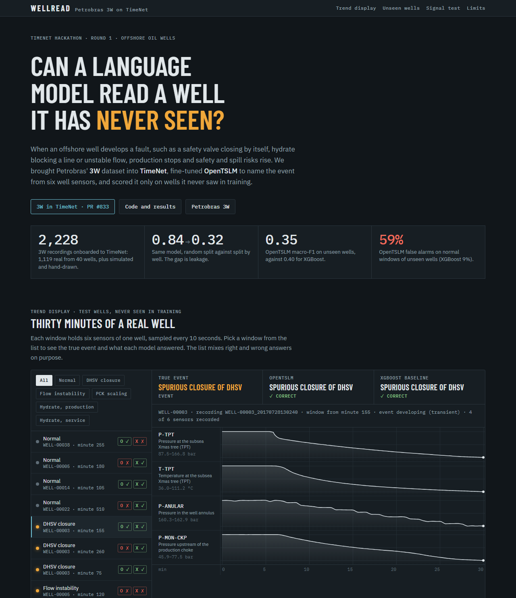

# WellRead

**Can a language model read an oil well it has never seen?** We brought Petrobras' 3W dataset of
abnormal oil-well events into [TimeNet](https://github.com/OpenTSLM/TimeNet), fine-tuned
[OpenTSLM](https://github.com/OpenTSLM/OpenTSLM) to name the event from raw sensor data, and scored
it only on wells it never saw in training. Project for the
[TimeNet Online Hackathon](https://challenge.timenet.ai/), Round 1 (November 2026).

<table>
<tr><td><b>TimeNet PR</b></td><td><a href="https://github.com/OpenTSLM/TimeNet/pull/833">OpenTSLM/TimeNet#833</a>: Petrobras 3W as the <code>petrobras/three-w</code> dataset, in TimeNet's <code>industrial</code> domain</td></tr>
<tr><td><b>Demo</b></td><td><a href="https://huggingface.co/spaces/timenet-3w/3w-on-timenet">huggingface.co/spaces/timenet-3w/3w-on-timenet</a>: test windows with both models' answers, results, split leakage, signal test</td></tr>
<tr><td><b>Full results</b></td><td><a href="docs/RESULTS.md"><code>docs/RESULTS.md</code></a>: every number, with the method behind it</td></tr>
<tr><td><b>Data</b></td><td><a href="https://github.com/petrobras/3W">Petrobras 3W</a> v2.0.0, CC BY 4.0</td></tr>
</table>

[](https://huggingface.co/spaces/timenet-3w/3w-on-timenet)

## Why it matters

When an offshore well develops a fault, such as a safety valve closing by itself, hydrate blocking
a line or unstable flow, production stops and safety and spill risks rise. 3W is the public benchmark for this
problem: 1,119 real events from 40 Petrobras wells, plus simulated and hand-drawn ones, 27 sensors at
1 Hz.

Time-series language models such as OpenTSLM promise a model that reads sensor data and talks about
it in plain language. Before anyone trusts one in a control room, two questions need an answer:

1. **Does it work on a well it has never seen?** A monitoring model is always deployed on new wells,
   and every well has its own set of working sensors and its own operating point.
2. **Does it read the signal at all?** OpenTSLM also writes each series' mean and standard deviation
   into its prompt, so it could answer from those numbers alone.

## What we built

1. **3W as a TimeNet dataset** ([PR #833](https://github.com/OpenTSLM/TimeNet/pull/833)). The
   connector reads all 2,228 instances from pinned, SHA-256-checked files and builds 2,228
   classification tasks and 1,142 event-localization tasks. Missing sensors are declared, never
   filled. A TimeNet maintainer has already ported it to the new connector API.
2. **An evaluation by well.** Test wells frozen on 2026-11-20 and scored once, paired bootstrap
   intervals, cross-validation by well, and a measurement of how much a random split inflates the
   score.
3. **OpenTSLM on 3W.** A bridge from TimeNet windows to OpenTSLM samples, training on Modal's free
   credits, and a comparison with XGBoost baselines on the same windows.
4. **A signal test.** Six perturbations of every window that break either the series or the
   statistics in the prompt, to see which one the model follows.
5. **Checked explanations.** A model that describes what the sensors did before answering, with
   every claim re-measured against the data by a script.

## Key results

All numbers are macro-F1 over 6 event types unless stated otherwise. **Event recall** is the share
of event windows flagged as any event; **false alarms** is the share of normal windows flagged as an
event.

**1. A random split makes the same model look 2.6× better.** Same XGBoost model and windows, 5-fold
cross-validation on the training and validation wells:

| Split | Macro-F1 |
|---|---|
| Random windows | 0.84 |
| By recording | 0.71 |
| **By well** | **0.32** |

Only the split by well measures what happens on a new well, so every other number here uses one.

**2. On unseen wells, OpenTSLM ties a classical baseline and raises far more false alarms.** Test
split, 8 held-out wells, scored once:

| Model | Macro-F1 | Event recall | False alarms |
|---|---|---|---|
| XGBoost, mean and std only | 0.26 | 0.05 | 0.03 |
| XGBoost, shape features | **0.40** | 0.34 | **0.09** |
| OpenTSLM (Llama 3.2 1B, SoftPrompt) | 0.35 | **0.37** | 0.59 |

The paired difference is −0.05 (95% CI −0.16 to 0.02), and cross-validation by well also gives a tie
(0.34 ± 0.03 against 0.32 ± 0.03). OpenTSLM does better on the two hydrate events and misses flow
instability. On the validation wells it had scored 0.51 against 0.22; that gain did not transfer.

**3. OpenTSLM reads the shape of the signal, and also leans on the statistics in its prompt.**

| Condition | Series | Statistics in prompt | Validation | Test |
|---|---|---|---|---|
| original | own | own | 0.51 | 0.35 |
| time shuffle | own, time steps shuffled | own | 0.19 | 0.11 |
| noise | Gaussian noise with the window's mean and std | own | 0.21 | 0.11 |
| no statistics | own | none | 0.09 | 0.22 |
| signal from another class | other class | own | 0.26 | 0.16 |
| statistics from another class | own | other class | 0.11 | 0.12 |

Every drop has a paired bootstrap interval entirely below zero. Shuffling the time order while the
prompt's statistics stay correct costs 0.32 on validation, so the model uses the temporal shape. When
the two channels disagree, on validation the answer follows the statistics about twice as often as
the signal; on test the conflict is inconclusive. This matches an independent probe of the published
OpenTSLM checkpoint on human activity data
([opentslm-signal-probe](https://github.com/ariannabalducci/opentslm-signal-probe)).

**4. Explanations can be checked, and they do not help accuracy.** Of the claims the explaining
model writes, 0.05% name a sensor that is not there, 3% give the wrong direction of change and 62%
are fully correct. Cross-validation macro-F1 is 0.36 ± 0.09 with explanations against 0.34 ± 0.03
without, with twice the false alarms, so the classifier stays label-only.

Per-class scores, cross-validation by well, the conflict analysis, the lead-time analysis, simulated
data and per-well normalization are in [`docs/RESULTS.md`](docs/RESULTS.md).

## How it works

**Data in TimeNet.** The connector lives in our fork, branch `feature/petrobras-three-w`, under
`datasets/petrobras/three_w/`, and is submitted upstream as PR #833. Everything here is built from
that dataset, not from the raw Parquet files:

```powershell
uvx --from "git+https://github.com/RenatoGallicola/TimeNet@feature/petrobras-three-w#subdirectory=packages/timenet-connectors" timenet-build build petrobras/three-w --no-isolation --local-registry ..\registry
uv run python scripts/make_windows.py ..\registry ..\data\windows --splits splits/wells_connector.json
```

The second command cuts **18,737 windows of 30 minutes** (180 points at 0.1 Hz) from 39 real wells,
with the connector's split by well (12,827 train, 2,690 validation, 3,220 test windows), 6 sensors
(`P-TPT`, `T-TPT`, `P-ANULAR`, `P-MON-CKP`, `P-JUS-CKGL`, `T-JUS-CKP`) and the 6 classes that have
real instances in at least 6 wells:

| Code | Class |
|---|---|
| 0 | Normal operation |
| 2 | Spurious closure of DHSV |
| 4 | Flow instability |
| 7 | Scaling in PCK |
| 8 | Hydrate in production line |
| 9 | Hydrate in service line |

`scripts/compare_windows.py` checks that the windows are identical to windows cut from the original
Parquet files. Missing sensors stay NaN with a mask. The window format is in
[`docs/DATA_CONTRACT.md`](docs/DATA_CONTRACT.md).

**Baselines.** XGBoost on scale-free shape features (trend, change, roughness, autocorrelation) or on
the mean and std of each sensor only. Random sensor dropout in training stops the model from learning
which sensors a well has, a shortcut that otherwise erases flow instability on new wells.

**OpenTSLM.** OpenTSLM-SoftPrompt on Llama 3.2 1B, starting from the published
`OpenTSLM/llama-3.2-1b-har-sp` checkpoint. Each present sensor is z-normalized for the encoder; the
prompt gives its code, description, mean and std; the target is the class name. Class-balanced
sampling and random sensor dropout; the encoder, projector and LoRA adapters are trained, the LLM
stays frozen. One A100 epoch takes about 12 minutes on Modal's free credits. All choices were made on
validation wells only.

Details of every step: [`docs/RESULTS.md`](docs/RESULTS.md).

## Limits

- The test split has 1 to 2 wells per event class. Per-class numbers and even macro-F1 move a lot
  with which wells land in test. The validation gain of OpenTSLM (0.51) disappeared on test (0.35).
- The bootstrap resamples instances, and windows of one well stay correlated, so read every interval
  as optimistic. We do not bootstrap over wells: there are too few.
- XGBoost uses fixed hyperparameters, and some of its feature choices were made after seeing test
  numbers, before the test wells were frozen on 2026-11-20 (`docs/DECISIONS.md`). This favours the
  baseline.
- One kept epoch, one backbone (1B), one architecture (SoftPrompt). Flamingo, larger backbones and
  ensembles were planned but not run.
- The explanations are descriptions of the signal that are checked against the data. They are not
  causal explanations of the event.
- The lead-time analysis was run for XGBoost only, and shows a clear early signal only for the
  spurious DHSV closure, so we make no early-warning claim.
- We do not compare with the 35.1% of arXiv 2608.04041: different classes, protocol and split.

## Reproduce

Setup (Windows, uv, Modal, Hugging Face tokens in `.env`) is in [`docs/SETUP.md`](docs/SETUP.md).
After building the dataset and the windows (above):

```powershell
# Baselines and evaluation
uv run python scripts/baselines.py ..\data\windows results\baselines.json
uv run python scripts/evaluate.py ..\data\windows results\predictions\opentslm_sp_run1_test.csv --compare results\predictions\xgboost_shape_test.csv --split test

# OpenTSLM on Modal (A100)
uvx modal run scripts/opentslm_modal.py::upload --src ..\data\windows --name windows
uvx modal run scripts/opentslm_modal.py::train --run-name run1 --epochs 2
uvx modal run scripts/opentslm_modal.py::predict --run-name run1 --windows windows --split test --out opentslm_sp_run1_test

# Perturbation tests
uv run python scripts/perturb.py make ..\data\windows ..\data\perturbed --split test
# for each condition <c> (original, time_shuffle, noise_signal, signal_from_other, stats_from_other, no_stats):
uvx modal run scripts/opentslm_modal.py::upload --src ..\data\perturbed\<c> --name <c>
uvx modal run scripts/opentslm_modal.py::predict --run-name run1 --windows <c> --split test --out opentslm_sp_run1_<c>_test
uv run python scripts/perturb.py xgboost ..\data\windows ..\data\perturbed --split test   # writes ..\data\perturbed\xgboost_test.json
uv run python scripts/perturb.py score ..\data\perturbed results\perturbation --predictions results\predictions\opentslm_sp_run1 --split test

# Folds by well, split leakage, rationales
uv run python scripts/make_folds.py ..\data\windows ..\data\folds --xgboost
uv run python scripts/split_leakage.py ..\data\windows results\split_leakage
uv run python scripts/rationales.py ..\data\windows --split val --check-file results\predictions\opentslm_rat_main_val.csv

# Demo data
uv run python scripts/export_demo.py ..\data\windows
```

Every decision, with its date and reason, is in [`docs/DECISIONS.md`](docs/DECISIONS.md). The work log
is in [`docs/STATUS.md`](docs/STATUS.md).

## Repository layout

| Path | Content |
|---|---|
| `scripts/` | Windows, baselines, OpenTSLM bridge and Modal training, evaluation, perturbations, rationales, demo export |
| `splits/` | Split by well of the connector, and the 3 folds by well |
| `results/` | Predictions, evaluation reports, charts |
| `demo/` | Static demo page, deployed to the Hugging Face Space |
| `docs/` | Full results, plan, decisions, data contract, setup, status |

## Team

[RenatoGallicola](https://github.com/RenatoGallicola) (data, TimeNet connector, evaluation, demo) and
[ariannabalducci](https://github.com/ariannabalducci) (model, explanations, signal test), MSc
students in Artificial Intelligence at Politecnico di Milano.

## Acknowledgements

Petrobras for releasing 3W under an open license; the OpenTSLM and TimeNet teams for the model, the
dataset format and the review of our connector; Aionic Labs and the ETH Zurich Agentic Systems Lab
for the hackathon.

## Citation

If you use the 3W data, cite it as its authors ask:

```
Vaz Vargas, R.E., de Melo Junior, A.J., de Campos Lima, C.B. et al. 3W Dataset 2.0.0: a realistic and
public dataset with rare undesirable real events in oil wells. Sci Data 13, 949.
https://doi.org/10.1038/s41597-026-07225-z (2026).
```

## License

Code: MIT. The 3W data keeps its own license (CC BY 4.0, Petrobras).
